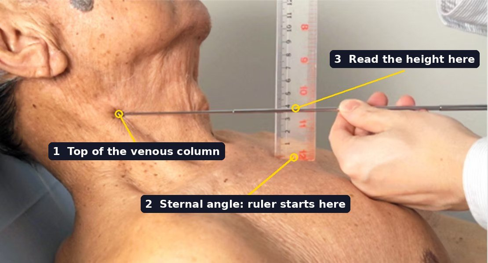

# Arterial Pulse and Jugular Venous Pulse

## 1. What is an arterial pulse?

Each time the left ventricle ejects, it pushes a fresh volume of blood into an aorta that is already full. The aortic wall stretches and the pressure inside it rises. That stretch and pressure rise travel down the arteries as a **wave**, like a ripple running along a tight hose. When the wave passes under your finger at the wrist, the artery wall bulges briefly: that bulge is the **pulse**.

LV ejection<b>→</b>Aortic pressure ↑<b>→</b>Arterial wall expands<b>→</b>Pressure wave travels

**The pulse is the wave, not the blood.** As the lecture stresses, the pulse does not depend on how fast the blood is moving. The wave races ahead: about 3–5 m/s in the aorta, and faster further out. It reaches the wrist in roughly a tenth of a second. The blood itself moves far more slowly, well under 1 m/s on average in the aorta. So when you feel the pulse, the blood that left the heart in that beat is still nowhere near your wrist.

**Why does the wave speed up?** A stiff tube passes a pressure wave on faster than a stretchy one, because a stiff wall barely gives, so the pressure change is handed on quickly. The lecture gives two examples:

- **The wave gets faster further from the heart.** The smaller arteries are stiffer than the stretchy aorta.
- **The wave gets faster with age.** The arteries become more rigid.

In both cases it is the wave that speeds up, not the blood.

<aside class="source-note"><strong>Source note:</strong> Wave speeds are approximate textbook values (Guyton and Hall): about 3–5 m/s in the aorta, 7–10 m/s in large branches, and faster in small arteries.</aside>

## 2. What do we assess when palpating a pulse?

The lecture lists five features:

| Feature | What you check | What it tells you |
|---|---|---|
| **Rate** | Beats per minute | How many beats are reaching the arteries |
| **Volume** | How big the bulge under your finger is | Mainly the pulse pressure: the rise from diastolic to systolic pressure, which grows with stroke volume |
| **Strength** | How firmly it pushes against your finger | How much pressure is in the artery |
| **Character** | The shape of each beat: how fast it rises and falls | How the left ventricle ejects, and how the aortic valve is working |
| **Location** | Which artery (radial, carotid, femoral…), and whether both sides match | A weak or missing pulse on one side points to a blockage on that side |

Whether the rhythm is **regular** is also worth noting.

**Why can the wrist count fewer beats than the heart makes?** In a very fast or irregular rhythm, some beats come so soon that the ventricle has hardly filled. Those beats eject too little blood to make a pulse you can feel. The pulse at the wrist can then be slower than the heart rate counted with a stethoscope. This difference is a **pulse deficit**.

## 3. Why is the jugular venous pulse visible in the neck?

There is no valve between the right atrium and the large veins of the neck. So, as the lecture explains, pressure changes in the right atrium pass straight up into the neck veins, and you can see them. The **internal jugular vein** acts like a gauge attached to the right atrium: the higher the right atrial pressure, the higher up the neck the column of blood reaches.

**Pressure moves; the blood doesn't have to.** A pressure change travels up the column of blood even while the blood itself keeps flowing down towards the heart.

**Why can you see it but not feel it?** Venous pressure is only a few mmHg, far too low to push against a finger. Even light pressure squashes the vein flat. What you see is a soft, flickering movement of the skin. The lecture notes that the JVP is not palpable.

**Breathing changes it.** Breathing in lowers the pressure inside the chest and draws blood into the heart, so the level in the neck **falls on inspiration**.

**Key distinction:** the arterial pulse is the left ventricle's ejection wave. The JVP shows the right atrium's pressure changes.

OPTIONAL VIDEO<h3>Understanding Jugular Venous Pressure (JVP)</h3>
Zero to Finals. Starts at 0:23. It loads only when tapped.
<button type="button" class="media-play" data-media-action="play-video" aria-expanded="false">Play video</button> <a class="media-outlink" href="https://www.youtube.com/watch?v=Z4yRBhlK0uY&amp;t=23s" target="_blank" rel="noopener noreferrer">Open on YouTube</a>

© Zero to Finals. Shown via YouTube's privacy-enhanced embed. The written explanation above does not depend on this video.

**Understanding Check: Sections 1–3**

<strong>1.</strong> You feel the radial pulse about a tenth of a second after the left ventricle ejects. What has travelled to the wrist in that time?A. The blood ejected in that beat, moving at about 8 m/sB. A pressure wave travelling along the artery wallsC. A nerve signal from the heart to the arterial muscleD. Sound from the closing aortic valve, carried by the blood

Show answer and explanation

<em>Answer: B.</em> The ejection starts a pressure and stretch wave that travels along the arteries far faster than the blood itself moves. You feel the wave, not the blood.

<strong>2.</strong> Why does the pulse wave travel faster in an elderly person?A. Their blood is thicker, so it carries pressure betterB. Their heart ejects blood at a higher speedC. Their stiffer arteries pass the pressure change on fasterD. Their arteries are wider, so blood meets less resistance

Show answer and explanation

<em>Answer: C.</em> A stiff wall hardly stretches, so it hands the pressure change on quickly. Arteries stiffen with age, so the wave speeds up, even though the blood does not.

<strong>3.</strong> Why can the JVP be seen but not felt?A. Venous pressure is too low to push against a fingerB. The jugular vein lies too deep to be touchedC. The JVP only appears when the patient breathes inD. Venous blood flows away from the heart in the neck

Show answer and explanation

<em>Answer: A.</em> Pressure in the neck veins is only a few mmHg. Any pressure from a finger squashes the vein, so you can only see the movement.

## 4. Why are the a, c and v waves separated by x and y descents?

In one heartbeat, the pressure in the right atrium rises three times (the **a**, **c** and **v** waves) and falls twice (the **x** and **y** descents). Each one follows from what the right atrium and the tricuspid valve are doing. They are the same atrial waves you meet on the Wiggers diagram. *(<a href="#/physiology/cvs/cardiac-cycle?section=9-reading-the-wiggers-diagram-one-trace-at-a-time">→ Cardiac Cycle, §9</a>)*

In order through one beat:

- **a wave: the right atrium contracts.** At the end of ventricular diastole, just after the P wave, the atrium squeezes and its pressure rises. There is no valve between the atrium and the great veins, so, as the lecture notes, venous inflow briefly stops and a little blood is pushed back up the veins.
- **c wave: the closed tricuspid valve bulges back.** As the right ventricle starts contracting, its rising pressure pushes the closed tricuspid valve so it bulges back into the atrium. The atrium itself is not contracting.
- **x descent: the atrium relaxes and is stretched open.** The atrium relaxes after its contraction. As the right ventricle ejects, it also pulls the tricuspid valve ring downwards, making the atrium bigger. Pressure falls.
- **v wave: the atrium fills with the tricuspid valve shut.** Blood keeps returning from the body throughout ventricular systole. With the tricuspid valve shut, it can only collect in the atrium, so pressure rises slowly. The atrium is not contracting.
- **y descent: the tricuspid valve opens.** When right ventricular pressure falls below right atrial pressure, the valve opens and the stored blood rushes into the ventricle. Atrial pressure drops.

| Wave | What causes it | When in the cycle |
|---|---|---|
| **a** | The atrium contracts | End of ventricular diastole |
| **c** | The closed tricuspid valve bulges back | Start of ventricular contraction |
| **x** | The atrium relaxes, and the valve ring is pulled down | Ventricular ejection |
| **v** | The atrium fills with the tricuspid valve shut | Late ventricular systole |
| **y** | The tricuspid valve opens and the atrium empties | Early ventricular diastole |

**A memory hook:** **a** for **a**trial contraction, **c** for the **c**losed valve bulging, **v** for **v**enous filling.

<figure class="learning-figure jvp-figure static-view"><figcaption>JVP waves at a glance</figcaption><svg viewBox="0 0 640 245" role="img" aria-label="Original schematic jugular venous pressure curve showing an a wave from atrial contraction, c wave during early ventricular systole, x descent from atrial relaxation, v wave during atrial filling, and y descent during tricuspid opening."><line x1="36" y1="203" x2="611" y2="203" stroke="currentColor" stroke-width="1.5" opacity=".5"/><line x1="36" y1="20" x2="36" y2="203" stroke="currentColor" stroke-width="1.5" opacity=".5"/><path d="M45 168 C75 166 93 88 120 76 C144 72 152 142 178 132 C195 129 199 104 214 111 C233 120 244 179 287 181 C340 185 355 101 407 91 C451 83 467 179 509 179 C543 181 558 167 595 166" fill="none" stroke="#2563eb" stroke-width="4" stroke-linecap="round"/><g fill="currentColor" font-size="15" font-weight="800"><text x="115" y="58">a</text><text x="207" y="97">c</text><text x="283" y="195">x</text><text x="405" y="75">v</text><text x="512" y="195">y</text></g><g fill="currentColor" font-size="12"><text x="42" y="18">Right atrial pressure ↑</text><text x="330" y="230">Time →</text></g></svg>
Original teaching schematic (not a patient tracing). The <strong>a, c and v</strong> are pressure rises; <strong>x and y</strong> are falls. Timing and actual prominence vary between patients.
</figure>
<figure class="learning-figure teaching-widget" data-widget="jvp-explorer" data-desc="sr"><figcaption>JVP wave explorer</figcaption>
Replaces the static curve. It shows one JVP trace, with the P wave, QRS, S1 and S2 marked above it, and a small right heart beside it. Next/Back steps through a → c → x → v → y. At each step the matching part of the trace is highlighted, and the heart shows what is happening: the atrium contracting, relaxing or filling; the tricuspid valve shut, bulging or opening; blood moving or collecting. One plain sentence underneath matches the bullet above. Schematic, not a patient tracing.
</figure>

OPTIONAL VIDEO<h3>JVP waveform explained</h3>
Catherine Tsai, UCSF School of Medicine. An animated walk through the JVP waveform. It loads only when tapped.
<button type="button" class="media-play" data-media-action="play-video" aria-expanded="false">Play video</button> <a class="media-outlink" href="https://www.youtube.com/watch?v=l_rXk8GflL0" target="_blank" rel="noopener noreferrer">Open on YouTube</a>

© Catherine Tsai. Written, illustrated, animated and voiced by Catherine Tsai, UCSF School of Medicine, Spring 2015, during her Medicine Sub-Internship at the SF VA Hospital. Shown via YouTube's privacy-enhanced embed. The written explanation above does not depend on this video.

OPTIONAL VIDEO<h3>Cardiac Cycle | Atrial Pressure | Part 3 | Jugular Venous Pulse | JVP | Cardiac Physiology</h3>
Byte Size Med. How the atrial pressure changes of the cardiac cycle produce the jugular venous pulse. It loads only when tapped.
<button type="button" class="media-play" data-media-action="play-video" aria-expanded="false">Play video</button> <a class="media-outlink" href="https://www.youtube.com/watch?v=9otb9X8hEeo" target="_blank" rel="noopener noreferrer">Open on YouTube</a>

© Byte Size Med. Shown via YouTube's privacy-enhanced embed. The written explanation above does not depend on this video.

## 5. How do you distinguish the JVP from the carotid pulse?

Both pulsations sit side by side in the neck, so they are easy to confuse.

| | **Jugular venous pulse** | **Carotid arterial pulse** |
|---|---|---|
| Can you feel it? | No: pressure is too low | Yes: a firm thrust |
| What it looks like | A soft flicker with more than one movement per beat | One sharp outward thrust per beat |
| When the patient sits up | The level falls | No change |
| On breathing in | The level falls | No regular change |
| Light pressure at the base of the neck | It disappears (the vein is squashed) | It continues |
| What it shows | Right atrial pressure | Left ventricular ejection |

Confusing the two leads to wrong conclusions about right atrial pressure.

<aside class="source-note"><strong>Source note:</strong> The lecture states that the JVP is not palpable and falls during inspiration. The other bedside differences are standard clinical teaching.</aside>

**Understanding Check: Sections 4–5**

<strong>1.</strong> Which JVP wave appears while the right atrium is filling and the tricuspid valve is shut?A. The a waveB. The c waveC. The v waveD. The y descent

Show answer and explanation

<em>Answer: C.</em> During ventricular systole the tricuspid valve is shut, so returning blood collects in the atrium and its pressure rises slowly: the v wave. The atrium is not contracting.

<strong>2.</strong> What causes the c wave?A. The right atrium contracting at the end of diastoleB. The shut tricuspid valve bulging back into the atriumC. Blood rushing into the ventricle as the valve opensD. The atrium filling while the ventricle ejects

Show answer and explanation

<em>Answer: B.</em> As the right ventricle starts contracting, its rising pressure pushes the closed tricuspid valve back towards the atrium, giving a small rise in atrial pressure. A is the a wave, C the y descent, and D the v wave.

<strong>3.</strong> At what moment does the y descent begin?A. When the pulmonary valve opensB. When the right atrium contractsC. When the tricuspid valve closesD. When the tricuspid valve opens

Show answer and explanation

<em>Answer: D.</em> Once the tricuspid valve opens, the blood stored in the atrium pours into the ventricle and atrial pressure falls.

<strong>4.</strong> A neck pulsation can be felt easily, shows one outward thrust per beat, and doesn't change when the patient sits up. What is it?A. The carotid pulse, from the left ventricle's ejectionB. The JVP, raised high by right-sided heart failureC. A giant v wave from tricuspid regurgitationD. The JVP, seen with the patient lying unusually flat

Show answer and explanation

<em>Answer: A.</em> A pulsation you can feel, with a single thrust and no change with position, is arterial. The JVP cannot be felt, has more than one movement per beat, and changes with posture and breathing.

## 6. How is the JVP estimated at the bedside?

The lecture's method:

1. **Recline the patient at about 45°**, with the head turned slightly to the left, and look at the right internal jugular vein.
2. **Adjust the angle until you can see the top of the pulsating column.** Sit the patient more upright if the neck veins are very full, or lie them flatter if the column is low.
3. **Find the sternal angle**, the ridge where the manubrium meets the body of the sternum, level with the second rib.
4. **Measure the vertical height** from the sternal angle up to the top of the column.

**Why measure vertically?** The pressure in a column of fluid depends only on its vertical height, not on how long or slanted it is.

**Why from the sternal angle?** It sits about 5 cm above the middle of the right atrium in most positions, so it makes a fixed reference point.

**Normal:** the top of the column is no more than about **3–4 cm** above the sternal angle. Higher than that means raised right atrial pressure.

<figure class="teaching-illustration" id="cvs11-jvp-measurement">

<figcaption><strong>Figure 01. Measuring the JVP at the bedside.</strong> (1) The pointer is held level with the top of the venous column. (2) A ruler stands vertically on the sternal angle. (3) Where the level pointer crosses the ruler gives the JVP height in cm.

Image credit
Bedside photograph supplied by the DOMiNANCE Breakdowns project; numbered labels added. Original source to be confirmed.
</figcaption>
</figure>

<aside class="source-note"><strong>Source note:</strong> The lecture gives the 45° position, sitting upright if very engorged, and measuring from the sternum. The normal value (no more than about 3–4 cm above the sternal angle) and the 5 cm offset are standard clinical teaching; the offset varies between people.</aside>

OPTIONAL VIDEO<h3>Jugular Venous Pressure (JVP) Examination - Clinical Skills - Dr Gill</h3>
Dr James Gill. Examining the JVP at the bedside: internal versus external jugular veins, interpreting the height, and the hepatojugular reflux test. Starts at 8:01. It loads only when tapped.
<button type="button" class="media-play" data-media-action="play-video" aria-expanded="false">Play video</button> <a class="media-outlink" href="https://www.youtube.com/watch?v=PecnLMSAAlw&amp;t=481s" target="_blank" rel="noopener noreferrer">Open on YouTube</a>

© Dr James Gill. Shown via YouTube's privacy-enhanced embed. The written explanation above does not depend on this video.

## 7. Which abnormal JVP waves are most important?

The lecture links three conditions to the JVP:

- **Right-sided heart failure: a raised JVP.** The right heart cannot pump on all the blood returning to it. Pressure backs up into the right atrium and the neck veins, so the column sits high.
- **Tricuspid regurgitation: a large wave during systole.** The leaky tricuspid valve lets the contracting right ventricle push blood back into the atrium, on top of the normal venous filling. The rise during systole becomes large. The lecture calls it a "big c wave"; because it joins the c and v waves, it is usually described as a giant **v** (or **cv**) wave.
- **Complete heart block: giant ("cannon") a waves.** The atria and ventricles beat independently. Sometimes the atrium contracts while the tricuspid valve is shut, because the ventricle is contracting at the same moment. The blood cannot go forward, so the pressure spikes up the neck. This only happens on the beats where the timing collides, so the giant a waves come and go. *(<a href="#/physiology/cvs/cardiac-conduction?section=8-clinical-significance-of-conduction-disturbances">→ Cardiac Conduction, §8</a>)*

<figure class="teaching-illustration teaching-illustration-portrait" id="cvs11-distended-neck-veins">

<figcaption><strong>Figure 02. A very high JVP.</strong> Grossly distended neck veins in a patient lying almost flat. Right atrial pressure is so high that the venous column reaches the angle of the jaw. (Cause in this patient: cardiac tamponade, where fluid around the heart stops it filling.)

Image credit
Photograph believed to be by Ferencga, Wikimedia Commons; supplied by the DOMiNANCE Breakdowns project. Licence to be confirmed.
</figcaption>
</figure>

**Key distinction:** a giant **a** wave is the **atrium contracting against a shut valve**. A giant **v** wave is the **ventricle pushing blood back through a leaky valve**.

<aside class="source-note"><strong>Source note:</strong> The lecture describes a "big C wave" in tricuspid incompetence. In practice, the regurgitant wave merges the c and v waves and is usually called a giant v or cv wave.</aside>

**Understanding Check**

<strong>1.</strong> Why is the JVP height measured vertically from the sternal angle?A. The sternal angle lies directly over the tricuspid valveB. The jugular vein runs straight up from the sternal angleC. Pressure in a column of fluid depends on its vertical heightD. Measuring along the neck would include the carotid pulse

Show answer and explanation

<em>Answer: C.</em> Only vertical height sets the pressure in a fluid column. The sternal angle is used because it sits a fairly constant distance above the right atrium.

<strong>2.</strong> A patient's JVP is 8 cm above the sternal angle, and their ankles are swollen. What does this most suggest?A. High right atrial pressure from right-sided heart failureB. Low right atrial pressure from blood lossC. A stiff aorta raising the speed of the pulse waveD. Tricuspid stenosis reducing the return of venous blood

Show answer and explanation

<em>Answer: A.</em> A column well above 3–4 cm means raised right atrial pressure. With swollen ankles, this fits a failing right heart that cannot pump on the blood returning to it.

<strong>3.</strong> In complete heart block, giant "a" waves appear in the neck only now and then. Why only sometimes?A. The atria contract only when the ventricles are relaxedB. Only some atrial beats fall while the tricuspid valve is shutC. The vagus nerve blocks every other atrial contractionD. Giant a waves appear only during deep inspiration

Show answer and explanation

<em>Answer: B.</em> The atria and ventricles beat independently, so only now and then does an atrial contraction land while the ventricle is contracting and the tricuspid valve is shut. Those beats give the giant waves.

<strong>4.</strong> How does the giant wave of tricuspid regurgitation differ from a giant ("cannon") a wave?A. It comes from the atrium contracting against a shut valveB. It appears only in diastole, while the tricuspid valve is openC. It can be felt as an outward thrust, like the carotid pulseD. It comes from the ventricle pushing blood back through a leaky valve

Show answer and explanation

<em>Answer: D.</em> In tricuspid regurgitation the ventricle drives blood back into the atrium during systole. A cannon a wave is the atrium itself contracting against a shut valve.

## 8. Chapter Essentials

1. **The arterial pulse is a pressure wave**, started by left ventricular ejection. It travels far faster than the blood itself.
2. **Stiffer arteries carry the wave faster:** further from the heart, and with age.
3. **Pulse features (lecture):** rate, volume, strength, character and location, plus rhythm. A pulse deficit means some beats are too weak to reach the wrist.
4. **The JVP shows right atrial pressure**, because no valve separates the right atrium from the neck veins. It can be seen but not felt, and it falls on inspiration.
5. **a** = the atrium contracts; **c** = the closed tricuspid valve bulges back; **x** = the atrium relaxes and the valve ring is pulled down; **v** = the atrium fills with the valve shut; **y** = the valve opens and the atrium empties.
6. **JVP versus carotid:** the JVP is not palpable, flickers more than once per beat, and changes with position, breathing and light pressure. The carotid is a single palpable thrust.
7. **Measurement:** recline at about 45° (adjust as needed) and measure the vertical height above the sternal angle. Normal is no more than about 3–4 cm.
8. **A raised JVP** means high right atrial pressure, as in right-sided heart failure.
9. **Giant v (cv) wave:** tricuspid regurgitation, the ventricle pushing blood back.
10. **Giant (cannon) a wave:** complete heart block, the atrium contracting against a shut tricuspid valve.
